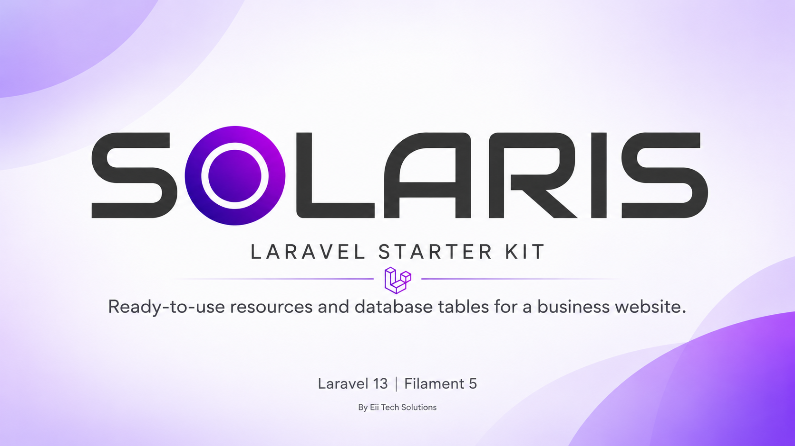

# SOLARIS



[](https://packagist.org/packages/eii/solaris)


**A practical starting point for building business websites with Laravel and Filament.**

Solaris gives you a ready-to-use content management backend for your next business website. It comes with a Filament admin panel, pre-built content models, database migrations, and management screens for common website content.

Instead of starting from scratch, you can begin with the content management foundation already in place and focus on building the website's frontend and features.

## What's included

Solaris provides ready-made content management functionality for the most common sections of a business website.

| Module | Description |
|---|---|
| **News** | Manage articles, excerpts, publishing dates, status, and categories. |
| **Events** | Manage event details, locations, dates, registration links, and categories. |
| **Blog** | Create and manage articles, authors, featured images, and publishing status. |
| **Recruitment** | Manage job listings, departments, employment types, locations, salaries, and application details. |
| **FAQs** | Organize frequently asked questions with categories, visibility, and display order. |
| **Categories** | Manage reusable content categories for news, events, and blog posts. |
| **Admin Panel** | Manage all supported content through Filament at `/admin`. |
| **Sample Data** | Optional seeders to populate the application with example content. |

## A starting point, not a finished website

Solaris provides the content management backend, not a pre-designed public-facing website.

You get the models, database structure, and admin interface needed to manage your content. You are free to build your own frontend, design, public pages, APIs, and integrations around them.

The root URL currently displays Laravel's default welcome page.

## Requirements

Before getting started, make sure you have:

- PHP 8.3 or later
- Composer
- Node.js and npm
- SQLite (default database) or another database supported by Laravel

## Getting started

Getting Solaris running locally is straightforward.

After cloning the repository, open a terminal in the project directory.

**1. Prepare the database**

Solaris uses SQLite by default. Create the database file if it doesn't already exist:

```sh
php -r "file_exists('database/database.sqlite') || touch('database/database.sqlite');"
```

**2. Install and configure the application**

Run the setup command:

```sh
composer run setup
```

This installs dependencies, prepares the environment, generates the application key, runs migrations, and builds the frontend assets.

**3. Start the development server**

```sh
composer run dev
```

**4. Open Solaris**

Visit the following URLs in your browser:

- Application: http://localhost:8000
- Admin Panel: http://localhost:8000/admin

That's it! You can now start exploring the admin panel and managing your website content.

The default database connection is SQLite. To use another database, update the `DB_*` settings in your `.env` file before running the setup process.

## Optional: Load sample content

Want to explore the admin panel with some example data?

Run the database seeder:

```sh
php artisan db:seed
```

This creates example news, events, blog posts, FAQs, job listings, categories, and a local administrator account.

**Demo administrator credentials:**

| Field | Value |
|---|---|
| Email | `admin@eii.com` |
| Password | `solaris` |

**Important:** These credentials are intended for local development only. Change or remove the demo account before deploying your application. Never seed this account into a production database.

## Development

Solaris is a regular Laravel application. You can modify its models, Filament resources, views, routes, and other application code as you would in any Laravel project.

**Run tests:**

```sh
php artisan test
```

**Useful commands:**

```sh
php artisan migrate       # Apply database migrations
php artisan db:seed       # Add example content
php artisan route:list    # Inspect application routes
npm run build             # Build frontend assets
```

## Project structure

The application follows a familiar Laravel structure:

```text
app/
  Enums/                  Content and workflow statuses
  Filament/
    Resources/            Admin resources, forms, tables, and views
  Models/                 Content models

database/
  migrations/             Database schema
  seeders/                Demo data and administrator

resources/
  views/                  Blade views
  css/
  js/                     Frontend assets

routes/                   Application routes
```

Filament automatically discovers resources under `app/Filament/Resources`. You can add new resources and extend existing ones as your project grows.

## Built with

- [Laravel 13](https://laravel.com/)
- [Filament 5](https://filamentphp.com/)
- PHP 8.3+
- Vite
- Tailwind CSS

## License

Solaris is open-sourced software licensed under the [MIT license](https://opensource.org/licenses/MIT).